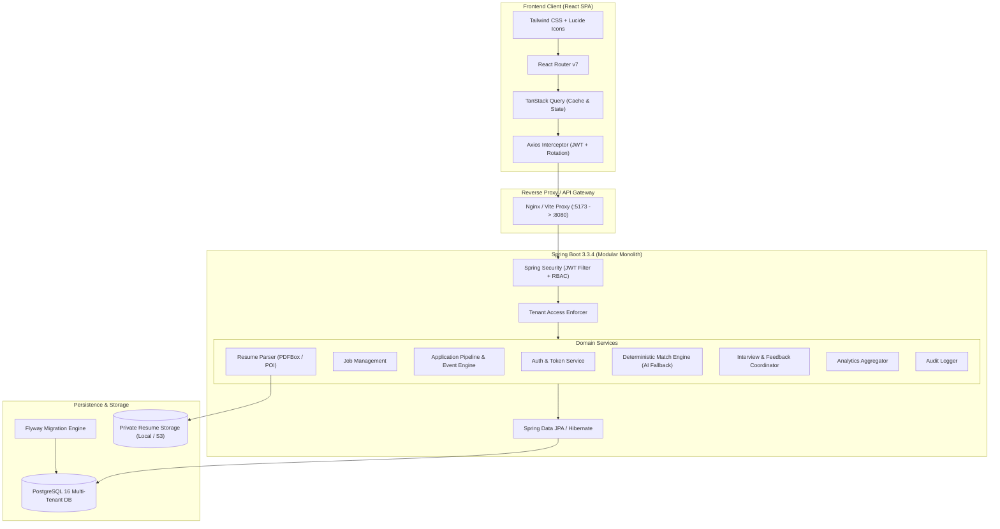
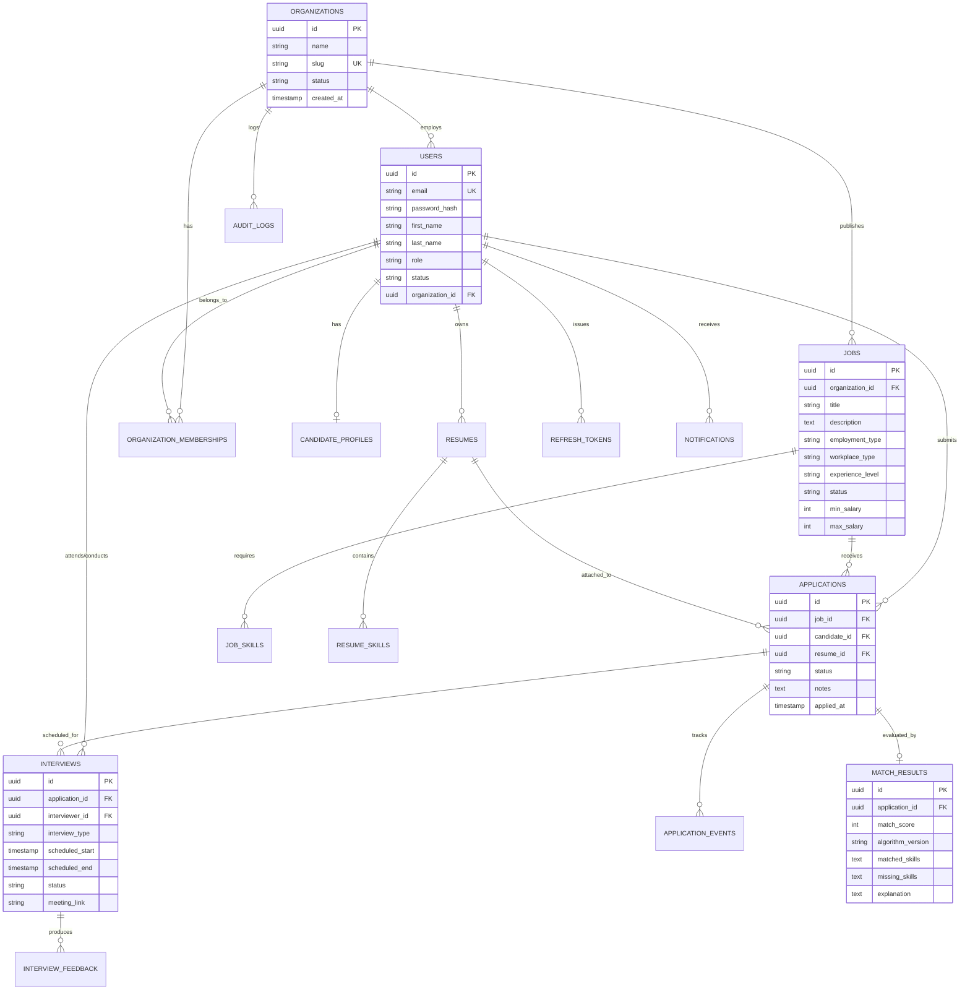

# HireFlow AI — Production-Style AI-Powered Recruitment SaaS Platform

[](https://www.oracle.com/java/)
[](https://spring.io/projects/spring-boot)
[](https://react.dev/)
[](https://vitejs.dev/)
[](https://tailwindcss.com/)
[](https://www.postgresql.org/)
[](https://flywaydb.org/)
[](LICENSE)

HireFlow AI is a multi-tenant enterprise recruitment management platform built to streamline hiring pipelines, parse unstructured resumes, evaluate candidate-to-job skill coverage with transparent explainability, coordinate interview rounds, and protect data across tenant boundaries.

Designed and engineered as a modular monolith adhering to Clean Architecture principles, HireFlow AI combines a Java Spring Boot 3.x backend with a React (JS/JSX) SPA styled using an enterprise Tailwind CSS design system.

---

## 1. Executive Product Overview

### Core Personas & User Journeys

1. **Recruiter (`RECRUITER`)**:
   - Manages organization workspace, job postings (Draft, Published, Paused, Closed).
   - Monitors candidate stages across an interactive Kanban pipeline and structured table view.
   - Evaluates transparent AI candidate matching scores with highlighted required & preferred skill evidence.
   - Schedules interview rounds, assigns interviewers, records ratings (1–5 scale), and submits structured hiring feedback.
   - Inspects DB-backed recruitment analytics (stage distribution, conversion rates, time-to-hire trends).

2. **Candidate (`CANDIDATE`)**:
   - Discovers public openings with full-text search, workplace type filters, and experience level criteria.
   - Submits single-click applications with customized cover notes and verified resume attachments.
   - Uploads PDF/DOCX resumes with automated text extraction powered by Apache PDFBox and POI.
   - Tracks application history, stage updates, interviewer notes, and upcoming interview calls in real time.

3. **Platform Administrator (`PLATFORM_ADMIN`)**:
   - Oversees global organizations, subscription tiers, and tenant lifecycle statuses.
   - Manages user identities with one-click suspension and reactivation capabilities.
   - Inspects an immutable system-wide audit trail with actor IP logging and entity payload tracking.
   - Configures runtime policies: JWT access/refresh token TTLs, file size limits, and AI engine fallback parameters.

---

## 2. High-Level Architecture



---

## 3. Database Schema & ER Diagram

The platform persists data across 16 normalized relational tables with UUID primary keys, foreign key constraints, composite indexes, and UTC timestamp auditing.



---

## 4. Key Engineering Highlights

### Transparent AI & Deterministic Match Engine
- **Deterministic Skill Coverage Engine**: Accurately computes exact coverage percentages against required skills (65% weight) and preferred skills (35% weight).
- **Skill Normalization**: Employs synonym aliasing (`React` = `React.js` = `ReactJS`, `K8s` = `Kubernetes`, `Postgres` = `PostgreSQL`).
- **Explainable Evidence Extraction**: Excerpts textual resume evidence proving where skills were detected in candidate documents.
- **Provider Fallback Strategy**: Pluggable AI adapter (`CandidateMatchingService`). In development or air-gapped environments without an external LLM API key, the deterministic engine executes locally with zero external network dependencies.
- **Fairness Guarantee**: The scoring pipeline strictly ignores names, gender, age, nationality, photographs, or protected demographics.

### Robust Multi-Tenant Boundary Enforcement
- Tenant boundaries are verified at the Spring Security service layer via `SecurityUtils.validateTenantAccess(targetOrgId)`.
- Recruiters cannot read, update, or transition applications or jobs belonging to another organization.
- Audit logs automatically record unauthorized access attempts with actor IDs and remote IP addresses.

### Document Extraction & Private Storage
- Implements magic byte signature validation (`%PDF-` for PDFs, PK ZIP structure for DOCX).
- Document parsing via Apache PDFBox 3.0 and Apache POI 5.3.
- Sandboxed local storage adapter stores files outside the web server's public root, preventing direct public access.

---

## 5. Technology Stack

| Layer | Technologies |
| :--- | :--- |
| **Backend Core** | Java 17/21, Spring Boot 3.3.4, Spring Web, Spring Security, Spring Data JPA |
| **Persistence** | PostgreSQL 16 (Production/Docker), H2 (Local Dev Fallback), Hibernate 6.x |
| **Migrations** | Flyway 10.x (`V1__init_schema.sql`, `V2__seed_demo_data.sql`) |
| **Authentication** | JJWT 0.12.6, BCrypt, Hashed DB-stored Refresh Tokens, Token Rotation |
| **Document Parsing** | Apache PDFBox 3.0.3, Apache POI 5.3.0 |
| **API Docs & Monitoring** | Springdoc OpenAPI 2.6.0 (Swagger UI), Spring Boot Actuator |
| **Frontend Framework** | React 19, Vite 8, React Router v7, TanStack Query v5 |
| **Frontend Styling** | Tailwind CSS 3.4, PostCSS, Autoprefixer, Lucide React Icons |
| **Forms & Validation** | React Hook Form 7, Zod 3.23 |
| **Charts & Analytics** | Recharts 3.x |
| **Testing** | JUnit 5, Mockito, Spring Boot Test |
| **DevOps & Containers** | Docker, Docker Compose, Multi-stage Dockerfiles, GitHub Actions |

---

## 6. Pre-Configured Synthetic Demo Accounts

The database seed migration (`V2__seed_demo_data.sql`) populates realistic test data across all three roles:

| Role | Email | Password | Primary Workspace / Description |
| :--- | :--- | :--- | :--- |
| **Recruiter** | `recruiter@acme.io` | `password123` | Acme Technologies (5 active jobs, candidate pipeline, interviews) |
| **Recruiter** | `recruiter@apex.io` | `password123` | Apex Global Cloud (Multi-tenant test organization) |
| **Candidate** | `candidate@hireflow.io` | `password123` | John Doe (Active applications, uploaded resumes, interviews) |
| **Platform Admin** | `admin@hireflow.io` | `password123` | Global Platform Admin (Audit trails, tenant suspension, configs) |

*Tip: The Login Page includes convenient **1-Click Demo Login** buttons to immediately test each persona.*

---

## 7. Local Quick Start Guide

### Option A: Standard Local Development (Zero Docker Required)

The backend is configured out of the box with an in-memory PostgreSQL-compatible database fallback, allowing immediate testing without installing PostgreSQL locally.

#### 1. Start the Spring Boot Backend

```bash
cd backend
./mvnw clean spring-boot:run
```
*(On Windows: `.\mvnw.cmd clean spring-boot:run`)*

- Backend REST API will start on: `http://localhost:8080`
- Swagger UI Interactive Documentation: `http://localhost:8080/swagger-ui.html`
- Health check: `http://localhost:8080/actuator/health`

#### 2. Start the React Frontend

In a separate terminal:

```bash
cd frontend
npm install
npm run dev
```

- Web Application will be available at: `http://localhost:5173`
- The Vite development server automatically proxies `/api` calls to `http://localhost:8080`.

---

### Option B: Full Containerized Stack (Docker Compose)

Run the full production-style stack with containerized PostgreSQL 16, Spring Boot backend, and Nginx frontend:

```bash
# Start all containers in background
docker compose up --build -d

# Verify container health
docker compose ps
```

- **Frontend Application**: `http://localhost:3000`
- **Backend API**: `http://localhost:8080`
- **PostgreSQL**: `localhost:5432`

To shut down the containers:
```bash
docker compose down -v
```

---

## 8. Automated Testing

### Backend Unit & Integration Tests

The test suite validates application state transitions, deterministic matching algorithms, resume binary signatures, and multi-tenant security boundaries:

```bash
cd backend
./mvnw test
```

**Test Coverage Summary:**
- `ApplicationTransitionTest`: Validates state machine rules (e.g., preventing illegal transitions from `REJECTED` to `OFFER`).
- `DeterministicMatchingServiceTest`: Verifies mathematical skill coverage scores, synonym resolution, and evidence generation.
- `ResumeTextExtractorTest`: Tests PDF/DOCX magic byte validation and rejection of spoofed extensions.
- `TenantIsolationTest`: Asserts that recruiters are blocked from reading or mutating other organizations' data.

---

## 9. API Reference & Sample cURL Requests

### 1. Authenticate (Recruiter Login)

```bash
curl -X POST http://localhost:8080/api/auth/login \
  -H "Content-Type: application/json" \
  -d '{
    "email": "recruiter@acme.io",
    "password": "password123"
  }'
```

*Response returns access token, refresh token, user details, and active organization membership.*

### 2. Search Published Jobs (Public / Candidate)

```bash
curl -X GET "http://localhost:8080/api/public/jobs?search=Java&workplaceType=REMOTE"
```

### 3. Create a New Job Posting (Recruiter)

```bash
curl -X POST http://localhost:8080/api/jobs \
  -H "Authorization: Bearer <ACCESS_TOKEN>" \
  -H "Content-Type: application/json" \
  -d '{
    "title": "Senior Java Cloud Engineer",
    "description": "Looking for an experienced Spring Boot engineer...",
    "responsibilities": "Design microservices, optimize PostgreSQL queries",
    "employmentType": "FULL_TIME",
    "workplaceType": "REMOTE",
    "experienceLevel": "SENIOR",
    "location": "San Francisco, CA",
    "minSalary": 140000,
    "maxSalary": 175000,
    "skills": [
      {"skillName": "Java", "isRequired": true, "category": "BACKEND"},
      {"skillName": "Spring Boot", "isRequired": true, "category": "FRAMEWORK"},
      {"skillName": "Docker", "isRequired": false, "category": "DEVOPS"}
    ]
  }'
```

### 4. Transition Application Stage (Recruiter Pipeline)

```bash
curl -X PATCH "http://localhost:8080/api/applications/<APPLICATION_UUID>/status" \
  -H "Authorization: Bearer <ACCESS_TOKEN>" \
  -H "Content-Type: application/json" \
  -d '{
    "status": "SHORTLISTED",
    "notes": "Candidate demonstrates strong Java 21 and Spring Data experience."
  }'
```

### 5. Inspect Recruiter Recruitment Analytics

```bash
curl -X GET http://localhost:8080/api/analytics/recruiter \
  -H "Authorization: Bearer <ACCESS_TOKEN>"
```

---

## 10. Security & Compliance Architecture

- **Stateless JWTs**: Access tokens carry a short 15-minute lifespan.
- **Hashed Refresh Token Rotation**: Refresh tokens are stored as SHA-256 hashes in PostgreSQL; re-use triggers automatic invalidation of the entire token family.
- **Password Protection**: BCrypt hashing with work factor 10.
- **SQL Injection Prevention**: 100% parameterized queries via Spring Data JPA and Hibernate.
- **Strict File Type Verification**: Does not trust file extensions; inspects magic bytes (%PDF- or PK ZIP) before text parsing.
- **Cross-Origin Resource Sharing (CORS)**: Strict origin whitelisting allowing only authenticated frontend origins.
- **Rate Limiting**: Configurable threshold protecting against credential stuffing attacks.

---

## 11. Known Limitations & Roadmap

1. **Email Service Adapter**: In local development, interview invitations generate application event logs and notifications rather than routing to a real SMTP server. Production requires setting `SPRING_MAIL_HOST` and credentials.
2. **Object Storage**: The default configuration stores uploaded resumes in a sandboxed private directory on the host (`./uploads/resumes`). An AWS S3 / MinIO adapter can be enabled by setting `STORAGE_TYPE=s3`.
3. **Optional LLM Integration**: The application operates deterministically with zero paid API keys. When `OPENAI_API_KEY` is provided, the system enriches match justifications and generates tailored interview question suggestions.

---

## 12. License

This project is licensed under the MIT License — see the [LICENSE](LICENSE) file for details.
